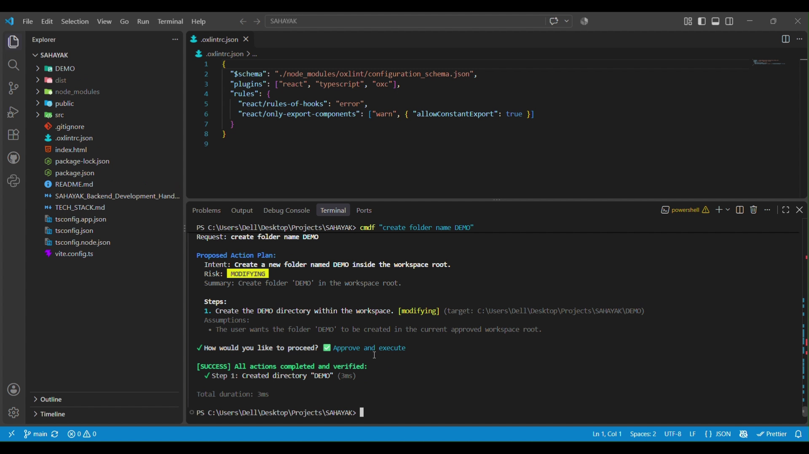
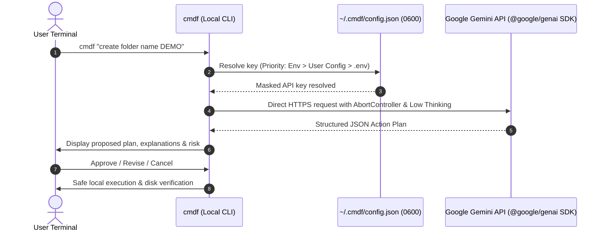

# cmdf — AI-Powered Terminal Assistant

> **Your intent. One command.**

[](https://www.npmjs.com/package/@prashantxdev/cmdf)
[](LICENSE)
[](https://nodejs.org/)
[](https://www.typescriptlang.org/)
[-purple.svg)](https://vitest.dev/)

**cmdf** is an open-source, cross-platform, natural-language terminal assistant. It translates your intent into structured, inspectable action plans and helps execute terminal, filesystem, and developer tasks.

Instead of memorizing complex shell commands, flags, or platform differences across Windows PowerShell, Windows Terminal, macOS Zsh, and Linux Bash, describe what you want in plain language. `cmdf` analyzes your environment, formulates a validated plan, categorizes risk, explains each step, and prompts you for approval or revision before making changes.

---

## Demo Video

Watch the cmdf demo to see installation, Gemini API key configuration, system verification with `cmdf doctor`, and command execution in action.

[](https://github.com/user-attachments/assets/4c364d17-3057-47da-8859-646a87c8b4f0)

▶️ **[Watch the cmdf Demo](https://github.com/user-attachments/assets/4c364d17-3057-47da-8859-646a87c8b4f0)**

---

## Setup

### 1. Install cmdf

Open your terminal (PowerShell, CMD, or VS Code terminal) and run:

```bash
npm install -g @prashantxdev/cmdf
```

### 2. Get your Gemini API key

Create an API key through [Google AI Studio](https://aistudio.google.com/apikey).

> **Note:** You may need to sign in to Google. API usage is subject to Google's current quotas and pricing.

### 3. Configure cmdf

Run the following command:

```bash
cmdf config set-key
```

When prompted, paste your Gemini API key into the terminal and press Enter to save it.

> **Security tip:** Keep your API key private. Never share it publicly or commit it to GitHub.

### 4. Verify your setup

Run:

```bash
cmdf doctor
```

This checks your environment and API connectivity.

**Facing timeout errors?** Follow the [Timeout Troubleshooting Guide](#timeout-errors) for steps to increase the request timeout and diagnose connection issues.

### 5. Run your first command

Use natural language to describe the task you want cmdf to perform.

**Example 1: Create a folder**

```bash
cmdf "create folder name DEMO"
```

**Example 2: Find Java files**

```bash
cmdf "find all Java files"
```

Follow the prompts displayed by cmdf to complete each task. Verify the results in your workspace.

---

## Key Features

- **Natural Language Intent Engine:** Handles intuitive developer tasks (e.g., `"create folder name DEMO"`, `"find all Java files"`).
- **Interactive Approval & Revision:** Three-option workflow allows approving (`✅ Approve and execute`), revising in place (`📝 Revise with instruction`), or cancelling safely (`❌ Cancel`) without side effects.
- **Fast, Bounded AI Generation:** Optimized generation with low thinking latency, strict deadline budgeting across attempts, and cancellation signals.
- **Structured Plan Validation:** Powered by Zod schemas to ensure every step has a valid action type, arguments, risk level, and explanations.
- **System Doctor Diagnostics:** `cmdf doctor` performs runtime checks, workspace validation, and a live API connectivity probe.
- **Three-Tier Risk Policy:**
  - **Read-Only:** File searches, directory listings, reading files, and Git logs.
  - **Modifying:** Creating directories, writing files, installing packages (requires approval).
  - **Destructive:** Deleting files or resetting Git trees (defaults to Cancel with high-visibility warnings).
- **Security-First Execution:**
  - Prefers deterministic Node.js filesystem APIs over general-purpose shells.
  - Prohibits `shell: true` on untrusted command strings; uses `spawn`/`execFile` with argument arrays.
  - Enforces workspace boundaries, preventing directory traversal (`../`) and drive-hopping.
  - Validates commands against a strict blocklist for destructive system calls (`rm -rf /`, `format`, fork bombs).
- **Genuine Dry-Run Simulation:** `--dry-run` simulates the plan without applying filesystem modifications.
- **Command Explanations:** `cmdf explain "<command>"` safely breaks down flags, read/write impact, and safety alternatives.
- **Cross-Platform:** First-class support for Windows PowerShell, Windows Terminal, macOS Zsh, and Linux Bash.
- **Offline Mock Provider:** Run offline or in CI with `--provider mock`.

---

## Bring Your Own Key (BYOK) Architecture

`cmdf` operates on a strict **Bring Your Own Key (BYOK)** model:

- **Direct local connection:** All Gemini API requests are dispatched directly from your terminal to Google's official Gemini API endpoint via the `@google/genai` SDK.
- **Zero middleman / Zero telemetry:** There is no developer-controlled proxy, server, or database. Your keys and workspace contents never touch third-party infrastructure.
- **Your key, your quota:** Every user supplies their personal Gemini API key. Requests consume your personal Google Gemini quota.
- **Strict secret protection:** Keys are masked in CLI output (e.g., `AQ.A••••••••••••••••••••_I5A`) and secured with restrictive local permissions.



---

## Supported Commands and Options

### Global Options

| Option | Description |
| :--- | :--- |
| `-v, --version` | Display version number |
| `-w, --workspace <path>` | Approved workspace root directory (defaults to current directory) |
| `-m, --model <name>` | Gemini model to use |
| `-p, --provider <name>` | AI provider (`gemini` or `mock`) |
| `-t, --timeout <ms>` | AI request timeout in milliseconds (defaults to `60000`) |
| `-d, --dry-run` | Simulate a plan without modifying files or executing commands |
| `-y, --yes` | Automatically approve non-destructive actions |
| `-h, --help` | Display command help |

### 1. Natural Language Task Execution (Default)

```bash
cmdf [options] [instruction...]
```

Translates your prompt into an action plan with an interactive `Approve / Revise / Cancel` prompt. If the instruction is omitted, launches interactive REPL mode.

```bash
# Execute task
cmdf "create folder name DEMO"

# Find files
cmdf "find all Java files"

# Dry-run simulation (no changes made)
cmdf --dry-run "create src/index.ts and initialize git"

# Auto-approve non-destructive read actions
cmdf -y "find all Java files"
```

### 2. Plan Inspection (`cmdf plan`)

```bash
cmdf plan [options] <instruction...>
```

Generates and displays the structured plan and explanations without executing any steps:

```bash
cmdf plan "find all Java files"
```

### 3. Command Explanation (`cmdf explain`)

```bash
cmdf explain [options] <command...>
```

Explains what a terminal command does, its flags, filesystem read/write effects, and risk classification without running it:

```bash
cmdf explain "git log -n 5 --oneline"
cmdf explain "rm -rf node_modules"
```

### 4. System Diagnostics (`cmdf doctor`)

```bash
cmdf doctor [options]
```

Inspects Node.js, npm, Git, OS, shell, workspace accessibility, credential storage permissions, and runs a live API connectivity probe:

```bash
cmdf doctor
cmdf doctor -m gemini-3.5-flash
```

### 5. Configuration (`cmdf config`)

```bash
cmdf config                       # Interactive configuration wizard
cmdf config list                  # View configuration table
cmdf config set-key [key]         # Save Gemini API key
cmdf config get-key               # View active key status and source
cmdf config delete-key            # Delete stored key
cmdf config set <key> <value>     # Update a specific setting (model, timeoutMs)
```

### 6. Execution History (`cmdf history`)

```bash
cmdf history                      # View recent request history
cmdf history --clear              # Clear history log
```

---

## Configuration Management

`cmdf` resolves your Gemini API key using strict precedence:

1. **Environment Variable (`GEMINI_API_KEY`)** — Highest priority (shell session or CI/CD).
2. **User Configuration (`~/.cmdf/config.json`)** — Recommended for personal machines (managed via `cmdf config`).
3. **Project `.env` file** — Convenient for local project development.

### Advanced Settings

You can customize the default model or request timeout:

```bash
# Set preferred Gemini model
cmdf config set model gemini-3.5-flash

# Set request timeout (in milliseconds)
cmdf config set timeoutMs 60000
```

The default request timeout is **60,000 milliseconds (60 seconds)**. If you experience slow responses, see [Timeout Errors](#timeout-errors).

### Environment Variables

You can also configure `cmdf` via environment variables:

**Windows PowerShell:**

```powershell
# Current terminal session:
$env:GEMINI_API_KEY="your_api_key_here"

# Permanent user environment variable:
[Environment]::SetEnvironmentVariable("GEMINI_API_KEY", "your_api_key_here", "User")
```

**macOS / Linux (`~/.bashrc` or `~/.zshrc`):**

```bash
export GEMINI_API_KEY="your_api_key_here"
export GEMINI_MODEL="gemini-3.5-flash"
```

**Local `.env` file:**

```env
GEMINI_API_KEY=your_api_key_here
GEMINI_MODEL=gemini-3.5-flash
CMDF_WORKSPACE=.
```

---

## Model Selection & Gemini Quota Guidance

`cmdf` supports Google Gemini models via `@google/genai`:

- **Recommended Model (`gemini-3.5-flash`):** Check current Google AI Studio availability and quota before choosing a model.
- **Thinking Models:** Some models support extended reasoning. Where supported, `cmdf` can use a low thinking level to reduce reasoning latency.
- **Deadline Budgeting & Native Cancellation:** `cmdf` enforces a total deadline budget (`Date.now() + timeoutMs`) across attempts. Retries are bounded, and requests are cancelled when the budget is depleted.

---

## Security & Execution Safeguards

1. **Workspace Boundary Containment:** All filesystem paths are checked using path normalization and security guards. Path traversal sequences (`../`), relative escapes, and drive-hopping outside the workspace are blocked before execution.
2. **No Arbitrary Shell Execution:** Deterministic filesystem operations (create file, create folder, list directory, search files, move, delete) use native Node.js APIs (`node:fs`). Shell commands only run when no native alternative exists, using sanitized `child_process.spawn` argument arrays.
3. **Command Validator:** Dangerous destructive system commands (`rm -rf /`, `mkfs`, `format`, fork bombs, `chmod 777 /`) are caught by the security policy and refused.
4. **Secret Redaction:** API keys, GitHub tokens, and private credentials are automatically scrubbed from error messages and history logs.
5. **Restrictive File Permissions:** On macOS/Linux, `~/.cmdf/config.json` is stored with `0600` (owner read/write only). On Windows, it is protected by Windows NTFS Access Control Lists (ACLs).

---

## Troubleshooting

| Issue / Error | Root Cause | Solution |
| :--- | :--- | :--- |
| `Daily Gemini API quota has been exhausted (429 RESOURCE_EXHAUSTED)` | Daily request limit reached on Free Tier | Check quota in Google AI Studio or switch model: `cmdf config set model <model-id>` |
| `Gemini planning request timed out after ...` | Model latency or network congestion | Increase timeout with `cmdf config set timeoutMs 90000`, then run `cmdf doctor`. See [Timeout Errors](#timeout-errors) for details. |
| `Gemini API key is not configured` | No key set in env, user config, or `.env` | Run `cmdf config set-key` to configure your key. |
| `Invalid or unauthorized Gemini API key (401/403)` | API key is invalid or revoked | Verify your key at [Google AI Studio](https://aistudio.google.com/apikey) and re-run `cmdf config set-key`. |
| `The configured Gemini model is unavailable or unsupported` | Model ID unavailable for your key | Update the model: `cmdf config set model <model-id>`. |
| `Permission denied` on config file | Insecure file mode on Unix systems | Run `chmod 600 ~/.cmdf/config.json` where applicable. |

### Timeout Errors

`cmdf` uses a default AI request timeout of **60 seconds (60,000 ms)**. If Gemini responds slowly because of model latency or network congestion, you can increase the timeout.

**Step 1: Increase the timeout**

```bash
cmdf config set timeoutMs 90000
```

This sets the timeout to 90 seconds.

**Step 2: Verify your configuration**

```bash
cmdf config list
```

Check that `timeoutMs` is set to `90000`.

**Step 3: Test your connection**

```bash
cmdf doctor
```

If the timeout persists, check your internet connection and verify that the selected Gemini model is available for your API key.

**Important:** Increasing the timeout only gives a slow request more time to complete. It does not fix exhausted API quotas (`429 RESOURCE_EXHAUSTED`), invalid API keys (`401/403`), or persistent network failures.

---

## Contributing

Contributions are welcome! If you would like to help improve `cmdf`, please feel free to open an issue or submit a pull request on [GitHub](https://github.com/prashantxdev/cmdf).

### Development & Testing

```bash
# Clone repository
git clone https://github.com/prashantxdev/cmdf.git
cd cmdf

# Install dependencies
npm install

# Compile TypeScript
npm run build

# Run unit and integration tests
npm test

# Type-check without emitting
npm run typecheck

# Lint check
npm run lint

# Dry-run package inspection
npm pack --dry-run
```

The current test suite reports 98 passing tests. Automated tests should use mocked providers or in-memory fixtures so they do not consume real API quotas.

---

## License

This project is independently developed and licensed under the [MIT License](LICENSE).

- **GitHub Repository:** [https://github.com/prashantxdev/cmdf](https://github.com/prashantxdev/cmdf)
- **npm Package:** [https://www.npmjs.com/package/@prashantxdev/cmdf](https://www.npmjs.com/package/@prashantxdev/cmdf)
