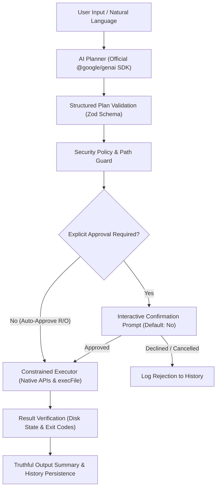

# cmdf — AI-Powered Terminal Assistant

> **Your intent. One command.**

[](LICENSE)
[](https://nodejs.org/)
[](https://www.typescriptlang.org/)
[](https://vitest.dev/)

**cmdf** is a cross-platform, AI-powered command-line assistant that translates natural-language instructions into structured plans and safely executes terminal, filesystem, and developer tasks.

Instead of memorizing esoteric shell commands, obscure flags, or platform differences between Windows PowerShell and macOS/Linux Bash, describe what you want in plain English. `cmdf` formulates a verifiable plan, displays exact risk assessments, asks for explicit confirmation before touching files, and verifies real disk outcomes.

---

## Architecture



---

## Key Features

- **Natural Language Intent Engine**: Understands synonyms, variations, and complex workflows (e.g. `"create src, tests, and docs folders"`, `"find TODO comments in my source code"`).
- **Interactive Clarification**: Never guesses missing paths or targets. Underspecified inputs (like `"create folder"`) trigger concise questions (e.g. `"What should the folder be named?"`).
- **Interactive & One-Shot Modes**: Execute single commands with `cmdf "<instruction>"` or launch a persistent REPL session with `cmdf`.
- **Security-First Execution**:
  - Deterministic Node.js filesystem APIs are preferred over spawning raw shell strings.
  - No untrusted commands are passed with `shell: true`. Processes use `spawn`/`execFile` with argument arrays.
  - Path traversal (`../`), symlink escapes, and drive-hopping outside the workspace are blocked.
  - System-destructive patterns (`format`, `rm -rf /`, `chmod 777 /`, fork bombs, privilege escalation) are strictly refused.
- **Three-Tier Confirmation Policy**:
  - **Read-Only**: Directory inspection, searching, and git logs.
  - **Modifying**: Creating directories, writing files, installing packages (requires explicit confirmation).
  - **Destructive**: Deleting files or resetting git trees (defaults to No with strong warning).
- **Verifiable Execution**: Never claims an operation succeeded unless verified on disk.
- **Genuine Dry-Run Simulation**: `--dry-run` simulates plans without modifying files or launching external commands.
- **Safe Command Explanations**: `cmdf explain "<command>"` safely dissects commands without running them.
- **System Doctor**: `cmdf doctor` inspects runtime versions, workspace boundaries, and AI provider connectivity without leaking secrets.
- **Local Mock Provider**: 100% testable and runnable offline without paid API keys.

---

## Technology Stack

- **Runtime**: Node.js LTS (>= 18.0.0)
- **Language**: TypeScript (Strict Mode)
- **CLI Framework**: Commander.js
- **Prompts**: `@inquirer/prompts`
- **AI Integration**: Google's official `@google/genai` SDK
- **Schema Validation**: Zod
- **Testing**: Vitest (37 automated tests passing)
- **Code Quality**: ESLint 9 & Prettier
- **Terminal Styling**: Chalk & Ora

---

## Installation & Setup

### Prerequisites

- Node.js LTS (>= 18.0.0) & npm (>= 9.0.0)
- Git

### Quick Setup

#### Windows (PowerShell)

```powershell
# 1. Clone repository
git clone https://github.com/cmdf/cmdf.git
Set-Location cmdf

# 2. Install dependencies
npm install

# 3. Create .env configuration
Copy-Item .env.example .env

# 4. Open .env and add your Gemini API Key from Google AI Studio:
# https://aistudio.google.com/
# GEMINI_API_KEY=your_gemini_api_key

# 5. Run typecheck, tests, and build
npm run typecheck
npm run test
npm run build

# 6. Link globally for local use
npm link

# 7. Verify installation
cmdf doctor
```

#### macOS / Linux

```bash
# 1. Clone repository
git clone https://github.com/cmdf/cmdf.git
cd cmdf

# 2. Install dependencies
npm install

# 3. Create .env configuration
cp .env.example .env
# Set GEMINI_API_KEY=your_key in .env

# 4. Run tests and build
npm run test
npm run build

# 5. Link globally
npm link

# 6. Verify installation
cmdf doctor
```

> **Note on npm publishing**: The package name `cmdf` has been verified as available on npm. It is not published automatically. To publish when ready, see [Release Steps](#release--publishing-guide).

---

## Configuration

Configuration is loaded in order of precedence:
1. CLI flags (`--workspace`, `--model`, `--provider`)
2. Environment variables (`GEMINI_API_KEY`, `GEMINI_MODEL`, `CMDF_WORKSPACE`)
3. User configuration file in `~/.cmdf/config.json`
4. Built-in defaults

### Environment Variables (`.env`)

```env
# Gemini API key obtained from Google AI Studio (https://aistudio.google.com/)
GEMINI_API_KEY=

# Default Gemini model (defaults to gemini-3.8-flash)
GEMINI_MODEL=gemini-3.8-flash

# Optional: Approved default workspace root (defaults to process.cwd())
CMDF_WORKSPACE=
```

### Viewing and Changing Configuration

```bash
# View active configuration
cmdf config

# Change a preference
cmdf config set autoApproveReadOnly true
cmdf config set historyLimit 50
```

---

## CLI Usage & Commands

### 1. One-Shot Mode

Execute a natural-language task directly:

```bash
cmdf "create a folder called my-project"
```

```text
cmdf v1.0.0 — Your intent. One command.
OS: windows (Windows_NT 10.0.26300) | Shell: powershell
Workspace: C:\Users\Dell\Desktop\my-project

Request: create a folder called my-project

Proposed Action Plan:
  Intent: Create directory "my-project"
  Risk:  MODIFYING 
  Summary: Create directory "my-project"

  Steps:
  1. Create directory "my-project" [modifying] (target: my-project)

? This plan will make modifications to your files or workspace. Proceed? (y/N) y

[SUCCESS] All actions completed and verified:
  ✔ Step 1: Created directory "my-project" (4ms)
```

### 2. Interactive Mode

Run `cmdf` without arguments to start an interactive REPL session:

```bash
cmdf
```

```text
cmdf v1.0.0 — Your intent. One command.
OS: windows (Windows_NT 10.0.26300) | Shell: powershell
Workspace: C:\Users\Dell\Desktop\my-project

Type your requests in natural language. Type "exit" or press Ctrl+C to quit.

? You: create folder

cmdf: What should the folder be named?

? You: components

Proposed Action Plan:
  Intent: Create directory "components"
  Risk:  MODIFYING 
  Summary: Create directory "components"

  Steps:
  1. Create directory "components" [modifying] (target: components)

? This plan will make modifications to your files or workspace. Proceed? (y/N)
```

### 3. Simulating with Dry-Run Mode

Simulate without modifying any files or executing processes:

```bash
cmdf --dry-run "create src, tests, and docs folders"
```

```text
[DRY RUN SUMMARY] — No changes were made:
  ⊘ Step 1: [Dry Run] Would execute: Creates src directory for source code (0ms)
  ⊘ Step 2: [Dry Run] Would execute: Creates tests directory for test suites (0ms)
  ⊘ Step 3: [Dry Run] Would execute: Creates docs directory for documentation (0ms)
```

### 4. Command Plan Inspection

View planned steps without executing them:

```bash
cmdf plan "initialize Git and create a gitignore file"
```

### 5. Explaining Commands Safely

Explain commands with security analysis:

```bash
cmdf explain "rm -rf build"
```

```text
Command to explain: rm -rf build

Explanation:
Warning: "rm -rf" forcefully and recursively deletes directories and files without prompting for confirmation. Any data inside will be permanently lost.
```

### 6. System Diagnostics

Run diagnostics to check environment health, Git status, workspace access, and AI connectivity:

```bash
cmdf doctor
```

### 7. Execution History

View or clear audit history (all secrets are automatically redacted before saving):

```bash
# View recent history
cmdf history

# Clear history
cmdf history --clear
```

---

## Security Model

Security is the foundational design pillar of `cmdf`:

1. **No Automatic Command Execution**: All mutating actions require explicit user confirmation.
2. **Default-No Approvals**: Confirmation dialogs default to `No` to prevent accidental enter-key executions.
3. **Workspace Boundary Enclosure**: Every path is resolved and validated to prevent path traversal (`../`), symlink escapes, or targeting system roots.
4. **Shell Injection Prevention**: Disallows command chaining (`&&`, `||`, `;`, `|`, `` ` ``, `$()`). Commands run via `spawn`/`execFile` with validated argument arrays.
5. **Strict Allowlist**: Only permitted developer tools (`git`, `npm`, `node`, `tsc`, `vitest`, etc.) can be spawned.
6. **Secret Redaction**: Keys matching Gemini, AWS, GitHub tokens, passwords, and private keys are redacted from logs and history.
7. **Protected Files**: `.git` internal objects, `.env`, `.env.local`, and SSH keys cannot be deleted or overwritten by AI requests.
8. **Truthful Verification**: Operations are verified on disk after execution; success is only reported if changes physically exist.

### Example: Blocked Dangerous Operation

```bash
cmdf "format drive C and delete everything"
```

```text
Error: Security Block: Command matches strictly blocked high-risk pattern.
Operation blocked for your safety.
```

---

## Automated Testing

`cmdf` includes 37 automated tests across 5 test suites using Vitest:

```bash
npm run test
```

```text
 ✓ tests/security.test.ts (11 tests)
 ✓ tests/filesystem.test.ts (9 tests)
 ✓ tests/executor.test.ts (5 tests)
 ✓ tests/planner.test.ts (8 tests)
 ✓ tests/cli.test.ts (4 tests)

 Test Files  5 passed (5)
      Tests  37 passed (37)
```

All tests run using the local `MockAIProvider`, requiring **zero API keys** and incurring **zero API charges**.

---

## Release & Publishing Guide

The package name `cmdf` is available on the npm registry.

To publish `cmdf` to npm when ready:

```bash
# 1. Run full verification suite
npm run typecheck
npm run lint
npm run format:check
npm run test
npm run build

# 2. Login to npm registry
npm login

# 3. Publish to npm
npm publish --access public
```

After publication, users will be able to install `cmdf` globally:
```bash
npm install -g cmdf
```

---

## License

MIT © [cmdf Contributors](LICENSE)
